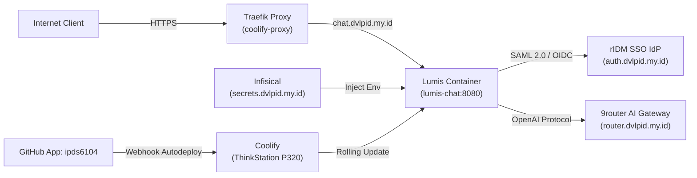

# ⚡ Lumis Enterprise Container Stack

[](LICENSE)
[](https://coolify.io)
[](docs/ARCHITECTURE.md)
[](https://router.dvlpid.my.id)
[](https://secrets.dvlpid.my.id)

Repositori ini menyediakan **Container Stack Enterprise-Ready** untuk men-deploy platform **Lumis AI** secara terotomatisasi (*autodeploy*) menggunakan **Coolify**, terintegrasi dengan **SAML 2.0 / OIDC SSO (rIDM)**, **9router AI Model Gateway**, dan **Infisical Secret Management**.

Target domain produksi: **`https://chat.dvlpid.my.id`**.

---

## 🏛️ Arsitektur Stack



---

## 📦 Komponen Stack

| Layanan | Domain / Host | Fungsi Utama |
| :--- | :--- | :--- |
| **Lumis AI** | `https://chat.dvlpid.my.id` | Frontend Svelte 5 + Backend Rust Axum 0.8 (<25MB RAM), Interactive Artifacts, Keyset pagination. |
| **Coolify Proxy** | Port 80, 443 | Traefik reverse proxy dengan sertifikat SSL Let's Encrypt otomatis & SSE streaming tanpa buffer. |
| **rIDM IdP** | `https://auth.dvlpid.my.id` | Single Sign-On (SSO) SAML 2.0 dan OIDC untuk autentikasi pegawai & pemetaan peran otomatis. |
| **9router** | `https://router.dvlpid.my.id` | Gateway inferensi AI multi-model dengan auto-failover dan kompresi token RTK (-40%). |
| **Infisical** | `https://secrets.dvlpid.my.id` | Manajemen rahasia dan kredensial terpusat tanpa hardcoded secret. |

---

## 🚀 Panduan Autodeploy melalui Coolify

### 1. Hubungkan Repository via GitHub App Coolify
1. Buka dashboard Coolify (`https://coolify.dvlpid.my.id`).
2. Masuk ke Project **Production** -> **+ New Resource** -> **Docker Compose**.
3. Pilih sumber: **GitHub App: `ipds6104`**.
4. Pilih repository: **`ipds6104/lumis-enterprise-stack`** (branch: `main`).
5. Coolify akan otomatis membaca `docker-compose.yml`.

### 2. Konfigurasi Environment Variables di Coolify / Infisical
Salin variabel lingkungan berikut atau sinkronisasikan otomatis via Infisical:

```bash
# Domain & Branding
PORT=8080
DATABASE_URL=sqlite:///data/lumis.db
LUMIS_BRAND_TITLE=BPS Enterprise AI
LUMIS_UPGRADE_CHANNEL=stable

# AI Gateway (9router)
OPENAI_BASE_URL=https://router.dvlpid.my.id/v1
OPENAI_API_KEY=sk-9router-master-key
DEFAULT_MODEL=my9model-free

# Enterprise Identity Federation (rIDM)
TRUSTED_USER_HEADER=x-forwarded-user
SAML_METADATA_URL=https://auth.dvlpid.my.id/t/bps/saml/metadata
SAML_SSO_URL=https://auth.dvlpid.my.id/t/bps/saml/sso
OIDC_ISSUER=https://auth.dvlpid.my.id/t/bps
```

### 3. Deploy
* Klik tombol **Deploy** di Coolify.
* Traefik akan otomatis menerbitkan sertifikat TLS Let's Encrypt untuk `chat.dvlpid.my.id`.
* Setiap push baru ke branch `main` akan memicu *zero-downtime rolling deployment*.

---

## 🛠️ CLI Management Script

Gunakan helper script [`scripts/coolify-manage.sh`](scripts/coolify-manage.sh) untuk berinteraksi dengan server Coolify di ThinkStation:

```bash
# Cek koneksi ke Coolify
./scripts/coolify-manage.sh status

# Daftar server terdaftar
./scripts/coolify-manage.sh servers

# Daftar aplikasi aktif
./scripts/coolify-manage.sh apps

# Trigger deploy aplikasi manual
./scripts/coolify-manage.sh deploy <app-uuid>
```

---

## 📄 Lisensi

Dilisensikan di bawah [MIT License](LICENSE).
