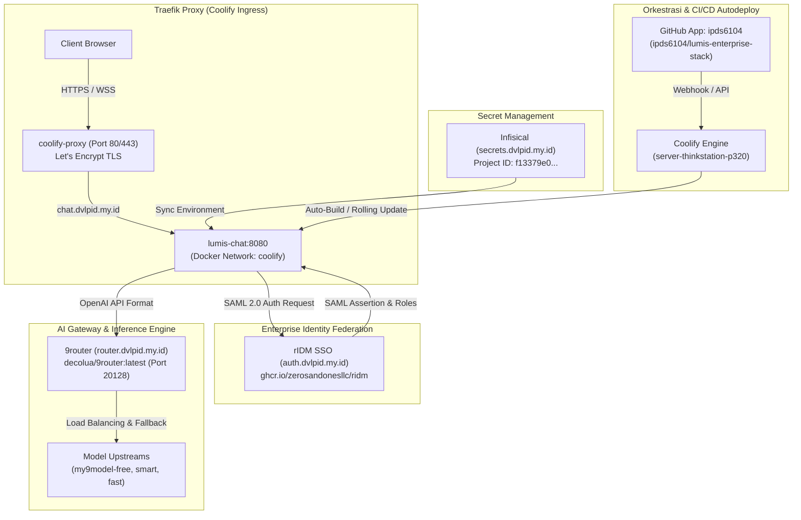

# 🏛️ Lumis Enterprise Stack Architecture

Dokumen ini mendefinisikan arsitektur container stack produksi untuk platform Lumis AI di lingkungan instansi/perusahaan, yang berjalan di atas server ThinkStation dan diorkestrasi melalui Coolify.

---

## 📐 Topologi & Alur Arsitektur End-to-End

---

## 🔒 1. Integrasi Identitas & SAML 2.0 (rIDM)

Stack ini menggunakan **rIDM** (`https://auth.dvlpid.my.id`) sebagai Identity Provider (IdP) terpusat:
- **Tenant Issuer**: `https://auth.dvlpid.my.id/t/bps`
- **SAML Metadata**: `https://auth.dvlpid.my.id/t/bps/saml/metadata`
- **SAML SSO URL**: `https://auth.dvlpid.my.id/t/bps/saml/sso`
- **OIDC Discovery**: `https://auth.dvlpid.my.id/t/bps/.well-known/openid-configuration`

### Pemetaan Peran (RBAC Hierarchy)
1. `SuperAdmin` (Level 5): Pengaturan global, SOC Emergency Killswitch, SCIM master.
2. `TenantAdmin` (Level 4): Administrasi divisi/satuan kerja.
3. `PowerUser` (Level 3): Clearance tier reasoning (`o1`, `deepseek-r1`), interactive artifacts.
4. `Member` (Level 2): Staf reguler (`gpt-4o`, `gemini-1.5-pro`).
5. `Guest` (Level 1): Pengguna terbatas (`flash` / `mini` models).

---

## ⚡ 2. AI Model Gateway (9router)

Alih-alih terhubung langsung ke vendor tunggal yang rentan *rate-limit* dan biaya membengkak, Lumis diarahkan ke **9router** yang dihosting lokal di Coolify:
- **Base URL**: `https://router.dvlpid.my.id/v1`
- **Internal Network**: Port 20128 di dalam bridge network `coolify`.
- **Fitur Otomatis**:
  - Multi-provider auto-fallback.
  - Kompresi RTK prompt (-40% token usage).
  - Model aliases: `my9model-free`, `my9model-smart`, `my9model-fast`.

---

## 🔄 3. Autodeploy via GitHub App di Coolify

1. **GitHub App**: `ipds6104` (App ID `3440090`, Installation ID `125492083`).
2. Setiap kali ada commit atau tag baru di branch `main` pada `ipds6104/lumis-enterprise-stack`:
   - Coolify secara otomatis menerima webhook payload.
   - Melakukan pull repository terbaru.
   - Menjalankan rolling deployment dengan zero downtime (Traefik healthcheck).
